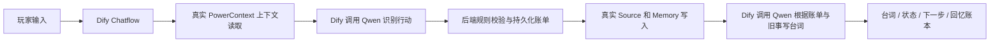

# 因果便利店 · 收据会记仇

> Dify × PowerContext 的三分钟互动游戏。买一瓶勇气汽水，欠一个真笑话；下一次进店，老板会记得你的选择。

本作品提交于队伍 `ssyyss12138/OceanBase-p` 的 `gjc-dify` 分支，开发历史基于赛事要求的 `2026-competition-ecosystem`。项目资产均在 `dify/`。平台填写实际推送的完整 commit SHA。

## 玩什么

便利店不收钱，只收承诺。玩家可以自由与老板说话，也可以输入明确行动：

| 行动 | 后果 |
| --- | --- |
| 买勇气汽水 | 每局限一瓶，欠一个笑话 |
| 买回声糖 | 买过汽水后才可购买，再欠一个笑话 |
| 讲笑话：具体内容 | 实际提供至少八个字的内容，还一个笑话；仅声称以前还过不算 |
| 坦白 | 承认还没准备好，留下坦诚信号 |
| 回忆 | 从实际读取的记忆里找旧事，不能编造 |
| 结算 | 根据欠账和坦诚状态，得到三种不同结局 |

三个结局分别是「守约合伙人」「诚实赊账客」「回声通缉令」。玩法、输入顺序和验收标准见 [完整体验样例](examples/ACCEPTANCE.md)。

## 技术实际起什么作用



- **Dify 1.9.2** 编排核心流程。提交的 `dsl/causal-store.yml` 包含原生 HTTP、Code、Answer 节点及失败分支。两个 HTTP 节点实际调用 Qwen，分别识别行动和生成台词，没有假模型、预录回答或仅转发到后端的聊天实现。不需要安装模型插件或自定义插件。
- **PowerContext** 使用固定官方源码 commit，真实保存玩家输入和已确认事件，在下一轮通过 `/v1/context/prepare` 读取。新聊天继续使用同一玩家 scope。显式记忆不需要为 PowerContext 配置额外生成、Embedding 或 Rerank 服务。
- **Python 后端** 负责确定性规则、scope 映射、状态版本校验和结算日志。业务 SQLite 只管理状态和恢复日志，不能替代 PowerContext 的记忆召回。该题允许 PowerContext 自身使用 SQLite 持久化。
- **Qwen 在线 LLM** 负责语义识别和角色台词。使用兼容 OpenAI 的 Chat Completions HTTP 协议，默认模型名 `qwen-plus`。根据实际百炼账号填写对应地域/业务空间的 Base URL，不把“千问网页版登录”当作 API 凭据。

## 运行环境

- macOS、Linux 或 Windows 的 Docker Compose 环境；Docker Engine 正常运行，建议为本项目准备 4 CPU、至少 6—8 GiB 可用内存。
- 首次安装需要访问镜像仓库、GitHub 和 Python 包仓库；运行时 Dify API 容器必须能通过 HTTPS 访问百炼模型地址。
- 需要可调用所选 Qwen 模型的 API Key。模型调用使用服务商的实际配额；本仓库不提供密钥或免费额度承诺。
- 开发和自测采用 Python 3.11—3.13；建议 3.12。版本及完整依赖见 `pyproject.toml`、`uv.lock`、`deploy/`。

## 从干净环境部署

以下命令在仓库的 `dify/` 目录执行。请先安装 Docker 与 Docker Compose；检查 `docker compose version`。

```bash
python3 scripts/init_config.py --output .env
```

脚本生成本次部署自己的随机密码和 token，并拒绝覆盖已有配置。编辑 `.env` 中三个模型参数：

```dotenv
MODEL_BASE_URL=你的百炼控制台显示的OpenAI兼容BaseURL
MODEL_NAME=qwen-plus
MODEL_API_KEY=你的APIKey
```

Base URL 到 `/v1` 为止，不含 `/chat/completions`；地域、业务空间及 Key 必须匹配。已有部署不能随意修改 `PLAYER_HASH_SECRET`，否则旧玩家存档将无法按原身份定位。真实 `.env` 不进入 Git。

```bash
docker compose --env-file .env -f deploy/compose.yaml config --quiet
docker compose --env-file .env -f deploy/compose.yaml up -d --build
```

首次 PowerContext 镜像构建可能较慢，因为它从固定官方 commit 安装运行时。等待 `powercontext` 健康、`api` 完成迁移后再继续。检查：

```bash
docker compose --env-file .env -f deploy/compose.yaml ps
curl --fail http://127.0.0.1:8090/health
curl --fail http://127.0.0.1:8080/console/api/setup
```

应用数据使用独立命名卷。正常停启保留数据；`down -v` 会删除该专用部署的数据，不能用作普通重开操作。

## 导入 DSL 与体验入口

只有一个应用 DSL，导入顺序为 `dsl/causal-store.yml`。`dsl/nodes/` 保存同一文件内嵌代码的可读源文件，不是第二个要导入的应用。

1. 浏览器打开 `http://127.0.0.1:8080/install`，创建本地 Dify 管理员，完成初始化。
2. 在工作室选择导入 DSL，导入 `dsl/causal-store.yml`。
3. 在工作流的环境变量中设置：

| 变量 | 本套 Compose 的值 |
| --- | --- |
| `GAME_URL` | `http://game:8090` |
| `GAME_API_KEY` | `.env` 的同名值，Secret 类型 |
| `MODEL_BASE_URL` | `.env` 的同名值 |
| `MODEL_NAME` | `.env` 的同名值 |
| `MODEL_API_KEY` | `.env` 的同名值，Secret 类型 |

4. 发布工作流，进入应用的运行页面。执行 `python3 scripts/new_save.py`，将随机码填入存档码输入框，即可开始。
5. 可通过 Dify 自带「API 访问」入口创建服务 API Key 并调用应用；无需另外部署前端。

**地址注意**：Dify 容器中的 `localhost` 指 Dify 自己，不能用它访问 game。Compose 使用服务名 `game`、`powercontext`。本机原生调试时，容器访问宿主机应改用相应平台的宿主机网关地址，并明确可达性；不要依赖临时隧道。

也提供针对**本项目全新专用 Dify 部署**的自动初始化/导入脚本。先安装开发依赖：

```bash
uv sync --frozen
uv run python scripts/check_model.py --config .env --output evidence/model-check.json
uv run python scripts/install_app.py --config .env --private-output .runtime/dify-app.json
```

脚本通过真实 Dify Console API 初始化管理员、导入和发布应用。账号、密码、服务 API Key 仅写入忽略的 `.runtime/dify-app.json`，不打印。已有 Dify 使用者应采用手动导入方式，避免将其当作任意已有实例的账号恢复工具。

## 验证与证据

```bash
uv run pytest -q
uv run python scripts/verify_dify.py \
  --private-config .runtime/dify-app.json \
  --output evidence/dify-e2e.json
```

`verify_dify.py` 会真实调用模型，验证三种结局、两名玩家隔离，以及**不携带旧 conversation_id 的新聊天**能在生成台词里使用先前随机记忆。

真实 PowerContext 单独联调与重启测试见 `scripts/verify_powercontext.py`、`scripts/verify_restart.py`；使用环境变量设置服务地址及 token。两阶段重启脚本要求在 before 与 after 之间实际重启 game 和 PowerContext。它不会把同一进程内重新建对象冒充服务重启。

当前完成范围与缺项见 [验证状态](evidence/STATUS.md)。已存在证据只代表记录中明确声明的检查，不等于自动获得比赛满分。平台评分以评审实际结果为准。

## 失败与恢复

- 模型识别失败时不进入结算；Dify 返回服务异常提示。
- 服务端校验行动枚举、输入长度和状态版本。重复同轮 commit 返回相同账单，不重复发放商品或扣账。
- 记忆写入中断时保留待处理日志。下一轮开始前先恢复；对不确定成功的 Memory 写入，从真实 PowerContext 条目核对相同事件，避免重复写入。
- 台词生成失败但结算已经成功时，返回真实账单并明确说明台词服务不可用；不会把它当作整轮没有发生。
- 模型的台词不能改变权威账单。历史上下文作为不可信数据传入，不能覆写游戏规则。
- 每个试玩存档最多 60 轮，限制演示存档增长。新随机存档码是无破坏的重开方式。

## 资料与限制

- 存档码是试玩环境中的访问凭证，建议使用生成器，不公开分享、不输入真实隐私。正式多人产品需增加用户登录与身份绑定；本项目没有声称具备此功能。
- 默认不需要 seekdb、知识库文件、Embedding、Rerank、语音或图片服务。初始商品由版本化规则定义，无需作者本地数据。
- 本套 Dify 部署服务于专用比赛演示；对公网开放前应按 Dify 官方部署要求增加 HTTPS 等配置。
- Qwen 默认别名可能更新；真实验收证据需记录实际返回的模型名称和结果。台词具有随机性，验收检查规则与因果，不要求逐字相同。
- 独立 Docker 构建、DSL 重导入和完整 Qwen 联调的真实完成状态，以 `evidence/STATUS.md` 为准，不能仅从源码或 Compose 语法检查推断完成。

本作品的玩法、DSL、后端和测试为本次比赛编写，没有复制公开娱乐 DSL。部署配置参考 [Dify 1.9.2 官方配置](https://github.com/langgenius/dify/tree/1.9.2/docker)；PowerContext 来自 [官方仓库](https://github.com/oceanbase/powercontext)，按其 Apache-2.0 许可使用，源码 commit 已固定；Qwen 服务遵循相应服务条款。

赛事原文：[Dify 题面](https://oceanbase.yuque.com/org-wiki-obtech-vh7w9r/hc3pio/lhfslihtnnb8yqh6)、[提交仓库要求](https://oceanbase.yuque.com/org-wiki-obtech-vh7w9r/hc3pio/brxxufkegusa86hl)、[官方 FAQ](https://oceanbase.yuque.com/org-wiki-obtech-vh7w9r/hc3pio/gp48z4pp0q3zg9b2)。技术文档：[PowerContext API](https://powercontext.oceanbase.io/zh/docs/develop/api-quickstart/)、[Qwen 首次调用](https://help.aliyun.com/zh/model-studio/first-api-call-to-qwen)。
